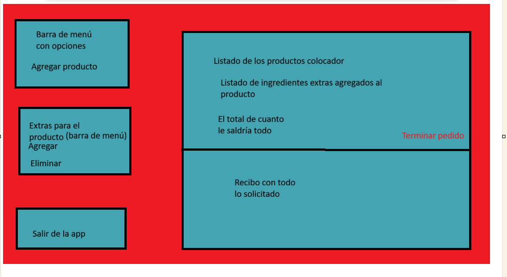
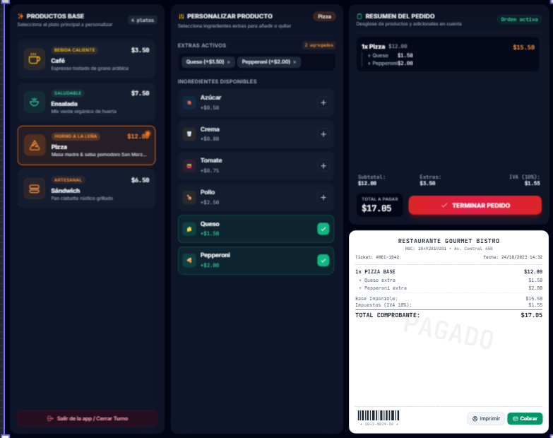

Imagen hecha por mi:

por la Ia

# Evidencias APP1 — PedidoLab

**Repositorio:** https://github.com/caguanafernando21-del/-icc-pap-pl1-patrones/blob/main/app/src/main/java/App1/plantilla-evidencias.md
**Integrantes:**  Fernando Caguana
**Fecha:** 08/11/2026

| Caso | Operación / entrada | Resultado esperado | Resultado real | Evidencia | Estado |
|---|---|---|---|---|---|
| CA01 | Clonar Cafe dos veces | IDs diferentes; ambos empiezan en $2.20 | Se generaron IDs únicos secuenciales con precio base de $2.20 | Prueba en interfaz POS |  Exito |
| CA02 | Comparar clon y objeto del registro | Referencias distintas; el prototipo conserva su configuración | Instancias con referencias de memoria independientes | Prueba en interfaz POS | Exito |
| CA03 | Al primer Cafe agregar Azucar y Crema | Descripcion incluye los dos ingredientes; costo actualizado | Muestra los ingredientes en lista y suma correcta de costos | Prueba en interfaz POS | Exito |
| CA04 | Consultar el segundo Café sin ingredientes | Mantiene $2.20, sin ingredientes | Segundo cafe independiente limpio de extras | Prueba en interfaz POS | Exito |
| CA05 | Clonar Ensalada y agregar Tomate y Pollo | Total correcto aplicando decoradores compatibles | Suma exacta de Ensalada ($7.50) + Tomate ($0.80) + Pollo ($1.80) | Prueba en interfaz POS | Exito |
| CA06 | Clonar Pizza y agregar Queso y Pepperoni | Total correcto aplicando decoradores compatibles | Suma exacta de Pizza ($12.00) + Queso ($1.50) + Pepperoni ($2.00) | Prueba en interfaz POS | Exito |
| CA07 | Intentar agregar Queso a Café | Operación rechazada; total y descripción no cambian | Alerta de validación mostrada; sin cambios en orden | Prueba en interfaz POS | Exito |
| CA08 | Agregar ingrediente sin pedido seleccionado | Mensaje claro y ningún cambio de estado | Alerta de advertencia al usuario por falta de selección | Prueba en interfaz POS | Exito |
| CA09 | Solicitar clon de clave inexistente | Fallo controlado; no se crea pedido | Manejo seguro de nulos en registro de prototipos | Prueba en interfaz POS | Exito |
| CA10 | Agregar dos veces Azúcar a un Café | Total correcto y dos aplicaciones del decorador | Descripción muestra las dos aplicaciones y suma ambos costos | Prueba en interfaz POS | Exito |
| CA11 | Reiniciar y volver a clonar Cafe | Nuevos pedidos parten nuevamente del valor base | Orden limpiada con botón de reinicio y lista para nuevo ciclo | Prueba en interfaz POS | Exito |

## Identificación de patrones

- **Prototype:** 
  - **Clase:** `RegistroProductosBas.java` (Registro de prototipos) y la clase abstracta `ProductoBase.java`.
  - **Método:** `clonar()` y `obtenerPrototipo()`.
  - **Descripción:** Se registran los prototipos base (`Cafe`, `Ensalada`, `Pizza`) y se generan copias independientes con IDs secuenciales unicos al seleccionarlos desde la interfaz
- **Decorator:** 
  - **Clase abstracta:** `DecoradorIngrediente.java`.
  - **Referencia:** Campo `pedidoWrappee` que envuelve al componente base o a otro decorador
  - **Decoradores concretos:** `Azucar.java`, `Crema.java`, `Tomate.java`, `Pollo.java`, `Queso.java` y `Pepperoni.java`.
- **Integración:** 
  - **Método de servicio:** `validarCompatibilidad()` en `ServicioPedidos.java` y `agregarIngrediente()` en `VentanaPrincipal.java`.
  - **Descripción:** Un clon seleccionado envuelve dos o mas decoradores tras validar las reglas de negocio de compatibilidad por categoria de producto.

## Decisiones de diseño

1. Diseño primero es algo minimalista, algo facil de comprender
2. La mejorada con mas botones para que pueda ver los botones

## Conclusiones

1.El patron Prototype permite clonar  los productos base con instancias e identificadores unicos

2.El patron Decorator habilito el poder añadir ingredientes y extras de buena forma, actualizando costos y descripciones de buena forma

3.La integración con Java Swing y ServicioPedidos sirvio para validar reglas en tiempo real, automatizo el desglose financiero y generó el recibo digital.